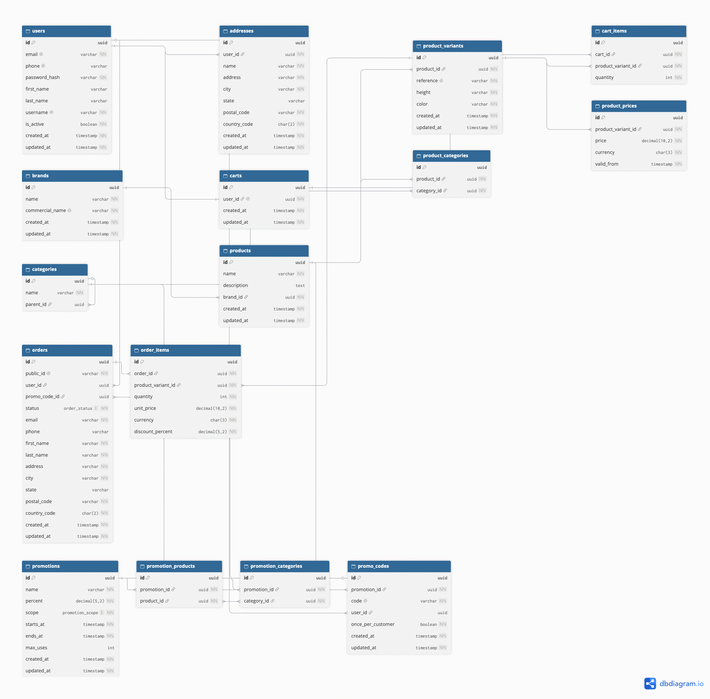

# Big Data Seeder

A realistic e-commerce dataset for PostgreSQL: catalog, customers, carts, promotions and orders, generated in SQL.

## Prerequisites

- Docker
- Docker Compose
- Make

## Getting started

### 1. Start the database

```sh
make up
```

The `postgres` container starts with the following credentials:

- database: `seeder`
- user: `postgres`
- password: `postgres`
- port: `5432`

Migrations are loaded on first startup.

### 2. Check the available commands

```sh
make help
```

### 3. Load the data

```sh
make seed
```

This command rebuilds the database from scratch, runs the migrations, then runs the seeders.

By default, `SCALE=1`, which is roughly:

- 50,000 customers
- 5,000 products
- 30,000 carts
- 500,000 orders

To change the volume:

```sh
make seed SCALE=<volume>
```

### 4. Explore

To open an interactive SQL console:

```sh
make psql
```

The analysis queries are in `scripts/`. To run them from the console:

```sh
make psql
\i /scripts/<script-name>.sql
```

## Database



## Project structure

```
migrations/   SQL migrations
seeders/      data generation in the database
scripts/      analysis queries
Makefile      make commands
```

## Make commands

| Command | Effect |
| --- | --- |
| `make` | list the commands |
| `make up` | start the container |
| `make down` | stop and remove the container |
| `make seed` | reset, migrations, seeders |
| `make migrate` | migrations only, on the current database |
| `make db-reset` | drop then recreate the empty database |
| `make psql` | interactive SQL console |
| `make shell` | shell in the container |
